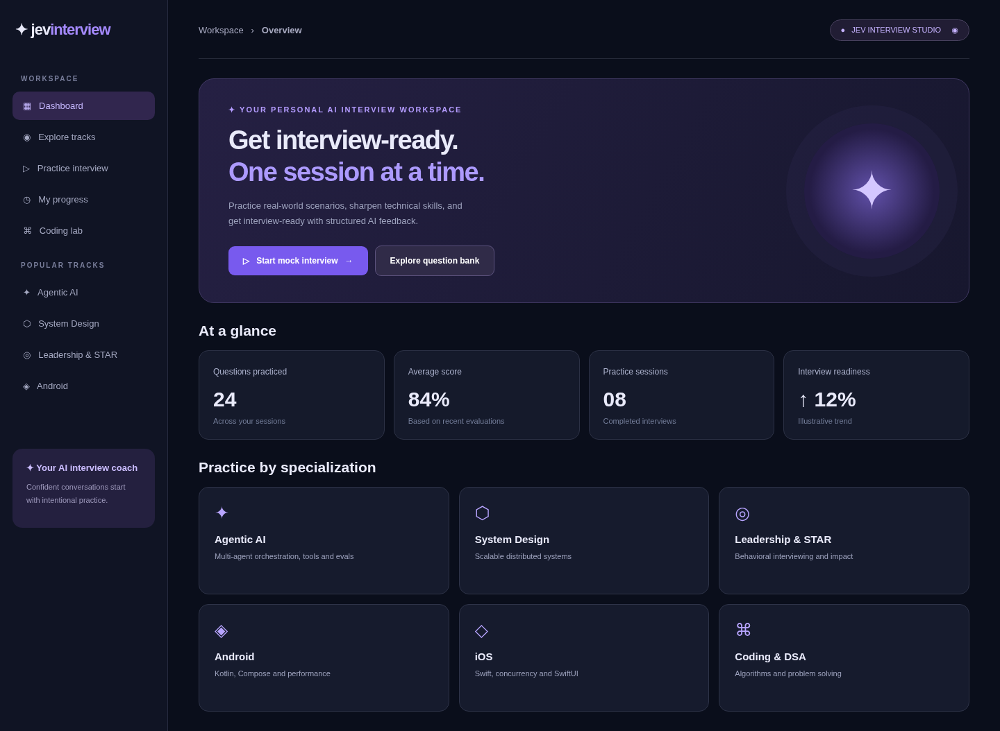
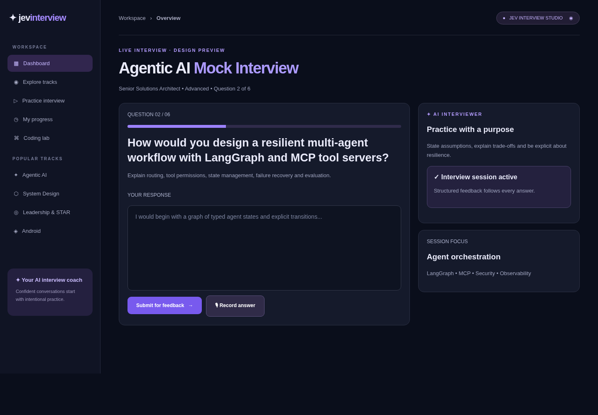
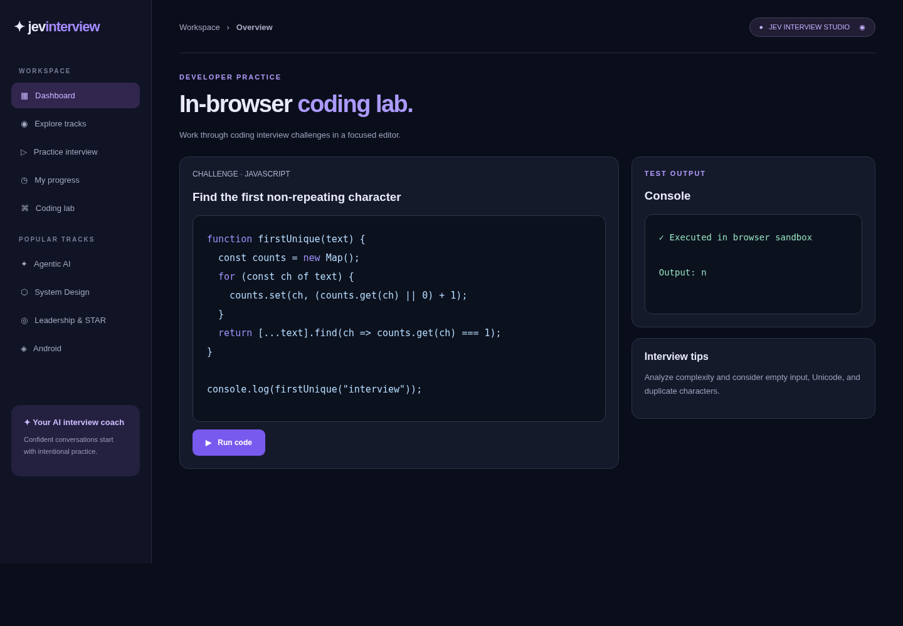
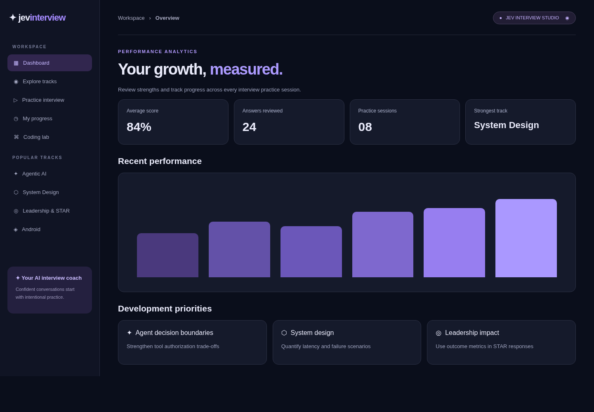
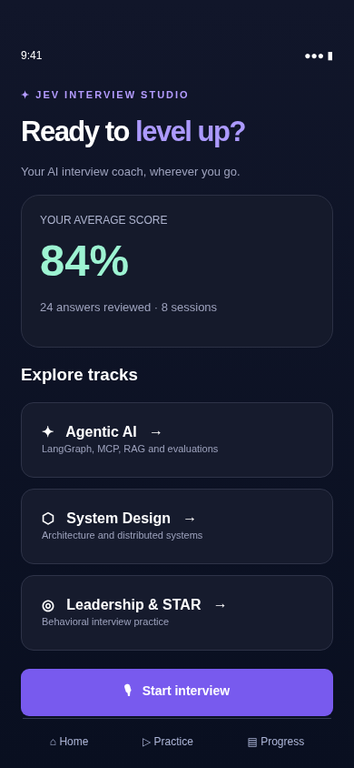

# Jev Interview Studio — Web + iOS + Android

An original interview-practice SaaS prototype, with React web, Expo React Native mobile, FastAPI, SQLite (local development), and optional AI/Stripe/Langfuse integrations.

## Product screenshots — design previews

These are **illustrative UI renders**, not captures from a deployed product. The dashboard sample metrics and coding-lab output are example content. The actual product currently has an authentication-first landing flow and its screens depend on real API responses.

### SaaS dashboard


### AI interview workspace


### Browser coding lab


### Progress and analytics


### iOS / Android mobile concept


## Features and boundaries

- Email/password registration, PBKDF2 password hashing, opaque session tokens, bearer token authentication and logout.
- Server-side per-user ownership of sessions, answers, history, progress, and billing status. Integration tests prove cross-user access is denied.
- Interview questions in eight tracks; submit answers and receive AI scoring with an API key; otherwise explicitly labelled heuristic demo scoring.
- LangGraph `evaluate -> followup` orchestration when dependency is installed; development fallback when LangGraph isn't installed locally.
- Interview voice answer: Expo on-device microphone capture -> authenticated API transcription -> editable text answer. This is **turn-based voice**, not low-latency bidirectional real-time speech.
- Browser-only JavaScript coding lab with sandboxed iframe; **not** a production-grade remote judge or multi-language execution service.
- Stripe Checkout session generation, verified Stripe webhooks, and local subscription status. Requires Stripe credentials; paywall/quota enforcement and advanced subscription lifecycle reconciliation not provided.
- Opt-in Langfuse tracing for interview followups; logged metadata avoids raw interview answer and auth token.
- Single-host Docker Compose setup; **not** a hardened multi-region production cloud release.

## Start web + API

```bash
cp .env.example .env
# Fill AI_API_KEY to enable real AI evaluations and transcription.
docker compose up --build
# open http://localhost:8080
```

FastAPI Swagger docs: http://localhost:8000/docs only when launching backend directly. The Compose API listens internally (not exposed on the host) behind Nginx `/api` reverse proxy.

```bash
cd backend
pip install -r requirements.txt
DATABASE_PATH=/tmp/jev-interview.db uvicorn app.main:app --reload --host 0.0.0.0 --port 8000
```

## Start mobile prototype

```bash
cd mobile
# Requires Node.js 22.13+ and Expo SDK 57.
cp .env.example .env
# Set EXPO_PUBLIC_API_URL=http://YOUR_COMPUTER_LAN_IP:8000
npm ci
npx expo start
```

Scan the Expo QR code from a physical iOS/Android device. Your phone and API host must be network reachable. Mobile voice capture uses `expo-audio` and an 8 MB per-clip transcription upload. Never embed `AI_API_KEY` or `STRIPE_SECRET_KEY` in Expo environment variables.

## Tests

```bash
cd backend
python -m pytest -q
```

## Security and production migration checklist

1. Deploy the API behind TLS using an authenticated reverse proxy; allowlist CORS and trusted hosts; rate limit registration, login, AI and voice endpoints; add email verification, password reset, token rotation, short lifetimes and abuse protections.
2. Replace SQLite with managed PostgreSQL and migration tooling. Consider row-level security and audit all tenant-scoped queries. Encrypt data at rest and in transit, define retention/deletion policies.
3. Restrict AI usage with per-user quotas and plan entitlement checks; billing must be authoritative via verified webhooks and periodic Stripe reconciliation.
4. Isolate any real coding judge in ephemeral container/VM sandbox without network, with hard CPU/memory/time/file limits, not in the API process. Never allow untrusted arbitrary code execution on the API host.
5. Use real-time streaming STT/TTS with a low-latency websocket/WebRTC architecture if a full-duplex conversational interviewer is required; current prototype is record-and-transcribe.
6. Add structured telemetry, alerts, SLOs, secrets manager, backup and restore drills, CI security scans, image pinning, SBOM, pentesting, HTTPS domain setup, production IaC and mobile app signing/release pipelines.
7. On native mobile, configure billing according to Apple App Store / Google Play policies before selling digital subscriptions; web Stripe Checkout does not establish app-store compliance.

## API examples

`POST /api/auth/register`, `POST /api/auth/login`, `GET /api/auth/me`, `POST /api/auth/logout`

`GET /api/tracks`, `GET /api/questions`, `POST /api/sessions`, `POST /api/sessions/{id}/answers`, `POST /api/sessions/{id}/followup`, `GET /api/sessions/{id}/history`, `GET /api/stats`

`POST /api/voice/transcribe` (multipart `audio`), `GET /api/billing/status`, `POST /api/billing/checkout`, `POST /api/billing/webhook`

© 2026 Jev Interview Studio. Original design and source code; not affiliated with Interview Genie.

## Single-VM HTTPS deployment reference

Use `compose.production.yml` with a DNS A record and a public host (`APP_DOMAIN=interviews.example.com`). Caddy terminates HTTPS and proxies the application. Before treating it as production, use managed Postgres, authenticated cloud secrets, verified automated backups, rate limiting, dedicated health monitoring, hardened images, and a penetration test. The standard Compose profile remains the local development configuration.

## Mobile dependency security

The mobile app uses Expo SDK 57 with a committed npm lockfile. Run `npm ci`, `npm run check`, and `npm run export:mobile` inside `mobile/` to reproduce dependency validation and the iOS/Android bundle builds. CI uses these same checks.

The October 10, 2026 dependency update reduced npm audit findings from 35 (23 high, 12 moderate) to 14 high findings, all propagated from two upstream advisories without published fixes. This is **not a clean security audit**. See [mobile dependency security notes](mobile/SECURITY.md) for versions, remaining exposure, and recheck commands.
