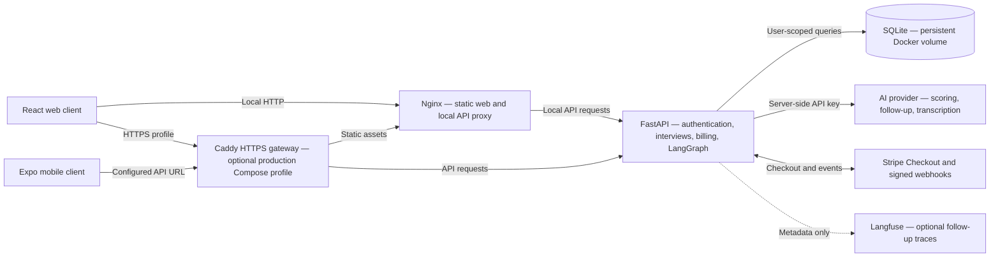
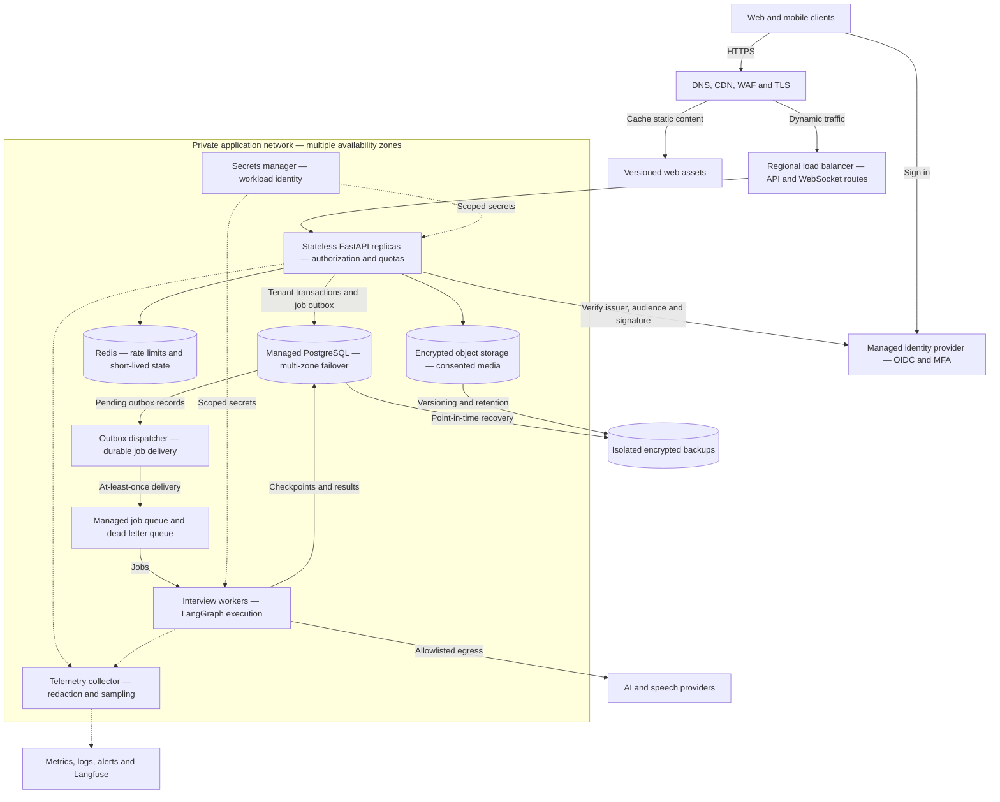
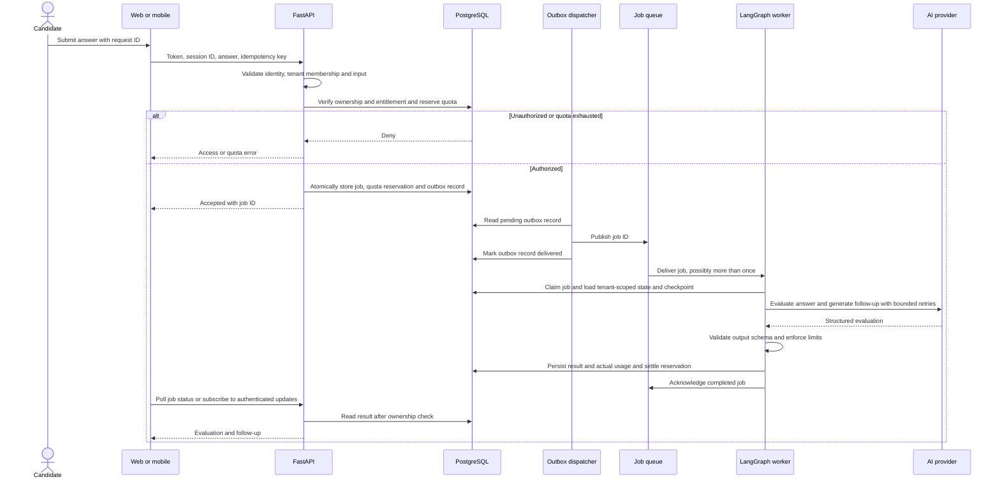
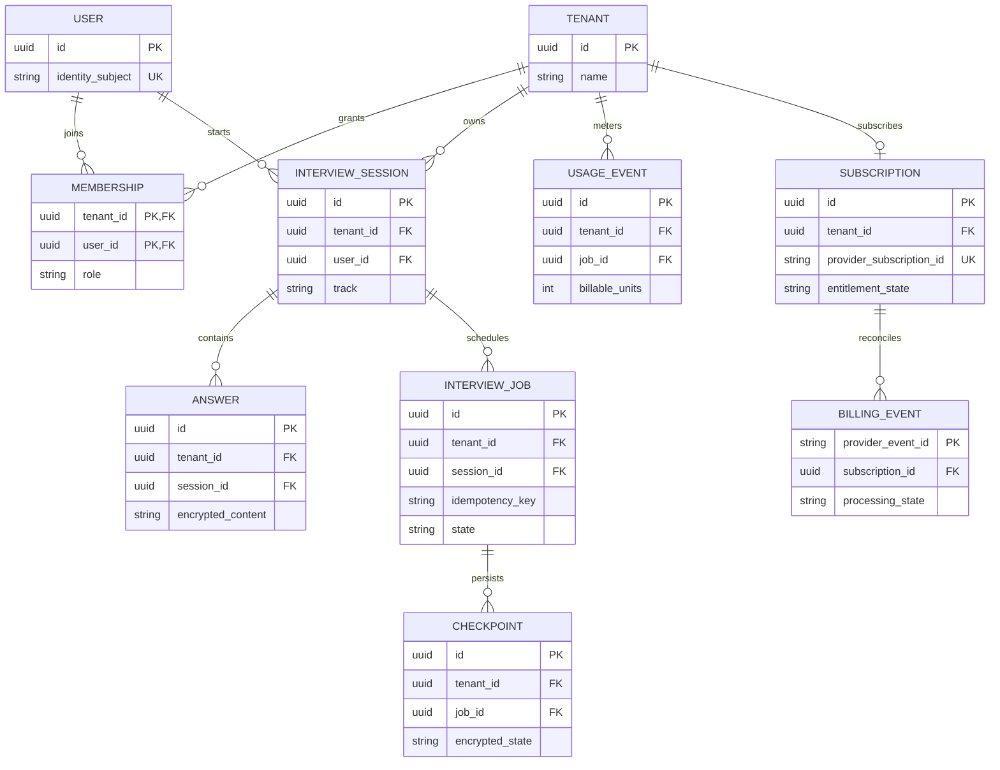
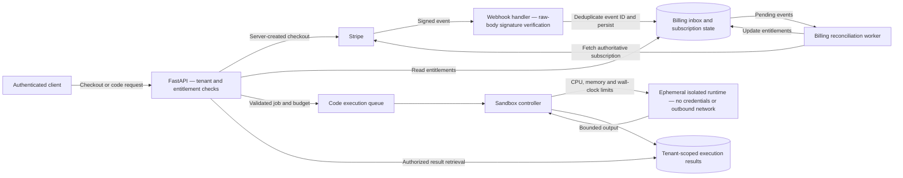

# Jev Interview Studio — SaaS architecture

**Status: proposed production design, not deployed infrastructure.** The first diagram describes the checked-in prototype. All subsequent diagrams describe a target architecture and require implementation, security review, infrastructure provisioning, and operational validation.

This reference uses a cloud-neutral, single-region, multiple-availability-zone deployment. Start with a modular FastAPI service plus separate workers; split services only when scaling or isolation requires it. No cloud account, region, capacity, availability SLA, or recovery target has been selected.

## 1. Current implementation

Source: [Compose](../../docker-compose.yml), [HTTPS profile](../../compose.production.yml), [Caddy routes](../../Caddyfile), [API](../../backend/app/main.py), and [integrations](../../backend/app/advanced.py). Mobile development can also connect directly to a separately launched API using its LAN address.

The prototype has user-level isolation, turn-based audio transcription, a browser JavaScript sandbox, and synchronous AI calls. It does **not** implement organization tenants, managed PostgreSQL, durable interview jobs, streaming voice, a remote code judge, or production quota enforcement.

## 2. Proposed production deployment

Only the edge and ingress expose public application endpoints. Database, cache, and queue access use private connectivity and distinct workload roles. API authorization remains mandatory even behind the WAF. Redis is not the system of record for billing or durable usage accounting. Multi-zone replicas improve resilience but do not establish cross-region disaster recovery.

Use bounded queues, per-tenant concurrency and token budgets, provider timeouts, circuit breakers, and backpressure. Alert on queue age, API error rate, latency, provider failures, and cost. Select measurable SLOs and recovery objectives before launch, then prove them with load tests and restore drills. Raw answers, audio, credentials, and payment data must not enter routine logs or traces.

## 3. Proposed authenticated interview flow

Outbox delivery and queue processing are at least once. Deduplicate by stable job/request ID, use leased job claims, and make database state transitions idempotent. A crash after a provider call can still repeat a billable request; use provider idempotency where supported and enforce retry budgets. Retry transient failures only; send exhausted jobs to a dead-letter queue and release or reconcile abandoned quota reservations. Worker checkpoints and results must share the same tenant boundary.

For a future full-duplex voice mode, add an authenticated WebSocket/WebRTC media session with short-lived credentials, concurrent-session limits, interruption handling, and transcript consent. The current record-and-transcribe endpoint is not that streaming system.

## 4. Proposed tenant and data model

This is a logical model, not a migration file. Apply composite foreign keys such as `(tenant_id, session_id)` and unique `(tenant_id, idempotency_key)` constraints. Derive tenant context from verified identity and membership, never from an unverified client header. Enforce ownership in the API and PostgreSQL row-level security with transaction-local tenant context; pooled connections must not retain tenant state, and application roles must not bypass RLS. Extend tenant checks to object keys, job payloads, caches, and checkpoints.

Each user can initially receive a personal tenant. Organization membership is a future capability, not a property of the current SQLite schema. Define deletion and retention policies across active data, provider-side data, and backups before collecting production interview material.

## 5. Proposed billing and isolated code execution

A checkout redirect never grants paid access. Acknowledge webhooks only after durable acceptance; process retries idempotently and reconcile out-of-order events against authoritative provider state. Periodically reconcile subscriptions and handle cancellation, refunds, disputes, and grace periods. Select a platform-appropriate mobile billing design before a store release.

The remote judge is optional future work. Use a dedicated sandbox worker pool or managed execution service with syscall restrictions, read-only base images, per-job isolation, output limits, and cleanup on timeout. No user code runs inside API or interview-worker processes. The checked-in coding lab executes JavaScript in a browser iframe and does not provide this infrastructure.

## 6. Proposed release and recovery pipeline

```mermaid
flowchart LR
    change["Pull request"]
    checks["Tests, bundle builds, secret and dependency scans"]
    review["Review and merge protection"]
    build["Build immutable images and web assets"]
    registry["Registry — signed artifacts and SBOM"]
    staging["Staging — integration and tenant isolation checks"]
    gate["Release approval and migration preflight"]
    migrate["Backward-compatible database migrations"]
    canary["Canary deployment"]
    health{"SLO and health checks pass?"}
    production["Promote and monitor"]
    rollback["Roll back application artifact"]
    restore["Scheduled backup restore drills"]
    change --> checks --> review --> build --> registry --> staging --> gate
    gate --> migrate --> canary --> health
    health -->|"Yes"| production
    health -->|"No"| rollback
    production -.-> restore
```

Use short-lived CI workload identity, separate staging and production accounts or projects, least-privilege deployment roles, and infrastructure as code. Do not put long-lived cloud credentials in repository files. Expand-and-contract schema changes must remain compatible with the previous application version; application rollback does not automatically reverse a destructive database migration.

The existing [CI workflow](../../.github/workflows/ci.yml) runs backend tests, the web build, and mobile dependency/configuration/bundle checks. Registry signing, security release gates, staging, canary rollout, and restore drills are proposed. Known mobile dependency findings remain documented in [mobile security notes](../../mobile/SECURITY.md); these diagrams do not resolve them or certify production readiness.

## Implementation sequence

1. Establish identity, tenant migration, PostgreSQL isolation tests, rate limits, and secrets management.
2. Add transactional jobs/outbox, durable LangGraph checkpoints, quota accounting, and billing reconciliation.
3. Provision multi-zone infrastructure, redacted telemetry, backups, and tested deployment/rollback procedures.
4. Add streaming voice or remote code execution only after their separate security and cost controls are validated.

Mermaid sources are embedded here so GitHub renders them and changes can be reviewed alongside code. Keep the current-state diagram grounded in code; change target-state diagrams as architectural decisions are accepted.
